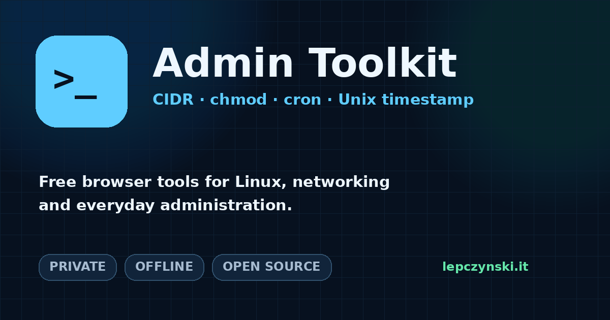

# Admin Toolkit

Free, privacy-friendly browser tools for everyday Linux, networking and administration tasks.

**Planned public URL:** https://admintoolkit.lepczynski.it



Polish deployment guide: [SETUP-PL.md](SETUP-PL.md)

## Included tools

- **CIDR Calculator** — network, broadcast, host range, subnet mask, wildcard mask and address counts.
- **chmod Calculator** — visual Linux read/write/execute permissions with numeric and symbolic output.
- **Cron Expression Generator** — common standard five-field Unix cron schedules.
- **Unix Timestamp Converter** — dates, Unix seconds, milliseconds, UTC and local time.

## Design goals

- Static HTML, CSS and JavaScript.
- No backend, account, cookies or analytics.
- Inputs are calculated locally in the browser.
- Installable PWA with offline support after the first successful visit.
- Separate, shareable and indexable URL for each tool.
- Automatic deployment from GitHub through Cloudflare Pages.

## Project structure

```text
admin-toolkit/
├── index.html
├── 404.html
├── cidr/index.html
├── chmod/index.html
├── cron/index.html
├── timestamp/index.html
├── assets/
│   ├── css/styles.css
│   ├── js/
│   ├── icons/
│   └── og/
├── _headers
├── _redirects
├── robots.txt
├── sitemap.xml
├── site.webmanifest
└── sw.js
```

## Update blog, YouTube, repository and project links

Edit one file:

```text
assets/js/config.js
```

The blog and YouTube channel are already configured. If the repository lives under another GitHub account, change `githubUrl`.

After publishing the related article and video, fill in:

```js
projectArticleUrl: "https://lepczynski.it/...",
projectVideoUrl: "https://www.youtube.com/watch?v=..."
```

Buttons for empty URLs remain hidden.

## Run locally

No build process is required. Serve the folder through a local web server so the service worker and absolute paths work correctly.

With Python:

```bash
python -m http.server 8080
```

Then open:

```text
http://localhost:8080
```

## Deploy with Cloudflare Pages

1. Push all files to the public GitHub repository.
2. In Cloudflare, open **Workers & Pages**.
3. Select **Create application** → **Pages** → **Import an existing Git repository**.
4. Authorize GitHub and choose the `admin-toolkit` repository.
5. Use `main` as the production branch.
6. Leave the framework preset as **None**.
7. Set the build command to `exit 0`.
8. Set the build output directory to `.` because the deploy-ready files are stored in the repository root.
9. Deploy.
10. In the Pages project, open **Custom domains** and add `admintoolkit.lepczynski.it`.

Every push to `main` will trigger a new production deployment.

## Updating the offline cache

When adding or renaming files, update the `PRECACHE_URLS` list in `sw.js`. When you need browsers to discard an old cache immediately, change:

```js
const CACHE_NAME = "admin-toolkit-v1";
```

to a new value such as `admin-toolkit-v2`.

## License

MIT License. See [LICENSE](LICENSE).

## Author

Created by [Wojciech Lepczyński](https://lepczynski.it).

- Blog: https://lepczynski.it
- YouTube: https://www.youtube.com/@WojciechLepczynski
