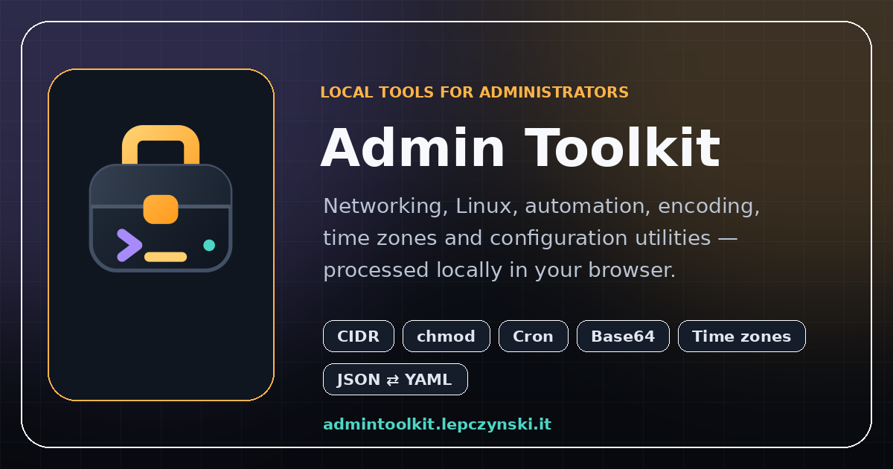

# Admin Toolkit

A small collection of free, privacy-friendly browser tools for Linux, networking, security and everyday system administration.

**Live site:** [admintoolkit.lepczynski.it](https://admintoolkit.lepczynski.it/)



## Tools

- **CIDR Calculator** — network, broadcast, host range, subnet mask, wildcard mask and address counts.
- **chmod Calculator** — visual Linux permissions with numeric and symbolic output.
- **Random Password Generator** — configurable password length and character sets using the browser cryptography API.
- **Cron Expression Generator** — common standard five-field Unix cron schedules.
- **Unix Timestamp Converter** — dates, Unix seconds, milliseconds, UTC and local time.

## How it works

The project uses plain HTML, CSS and JavaScript. There is no application backend, account system, analytics or cookie tracking. Calculations and password generation run locally in the browser.

The site is also an installable PWA. After the first successful visit, its core pages and assets are available offline through a Service Worker cache.

## Run locally

No build process is required:

```bash
python -m http.server 8080 --directory public
```

On Windows, use `py` if `python` is not available:

```powershell
py -m http.server 8080 --directory public
```

Then open `http://localhost:8080/`.

## Deployment

The `public/` directory is deployed as static assets with Cloudflare Workers. Every push to the `main` branch triggers the production deployment.

See [CLOUDFLARE-GITHUB.md](CLOUDFLARE-GITHUB.md) for the Cloudflare configuration.

## Project story

Admin Toolkit is the browser-based companion to my ESP32 Pocket Admin Toolkit project:

- [Read the article](https://lepczynski.it/en/other/pocket-admin-toolkit-a-practical-admin-tool-built-on-esp32/)
- [Watch the video](https://www.youtube.com/watch?v=lrTHDVkG1Hk)

## License

MIT License. See [LICENSE](LICENSE).

Created by [Wojciech Lepczyński](https://lepczynski.it/).
